# sepsim — Satellite Separation Simulator

Simulates the relative motion of multiple satellites after separation from a
launch vehicle dispenser, to assess re-contact and collision risk between
satellites and the upper stage in the hours and days after deployment.

**Goal:** find separation sequences (timing and direction for each satellite)
that avoid re-contact and keep all objects above a minimum safety distance.

**[▶ Live 3D demo](https://sebastianljungblad.github.io/sat-separation-sim/)** – a robust
separation plan for three satellites, propagated for 21 days with J2 and drag. Rotate
the Earth, zoom from 26 000 km down to the satellites at true scale, and replay the
close passes.

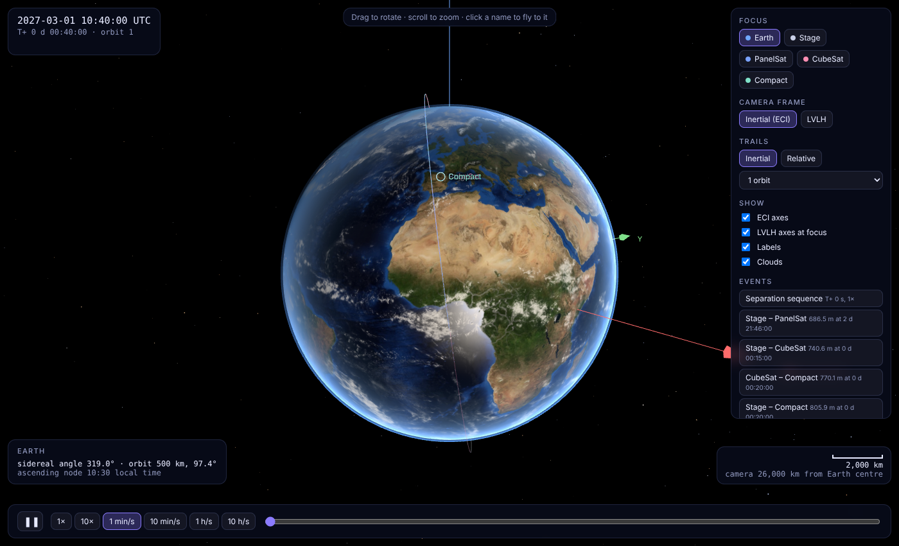

## Motivation

Multi-satellite dispensers release payloads in a predefined sequence. Orbital
relative motion is counterintuitive: a satellite pushed radially outward
returns to the dispenser after one orbit, and a satellite pushed forward ends
up *behind* it. This project explores how separation sequence, direction and
velocity affect the minimum distance between objects.

## Interactive planner app (v0.5)

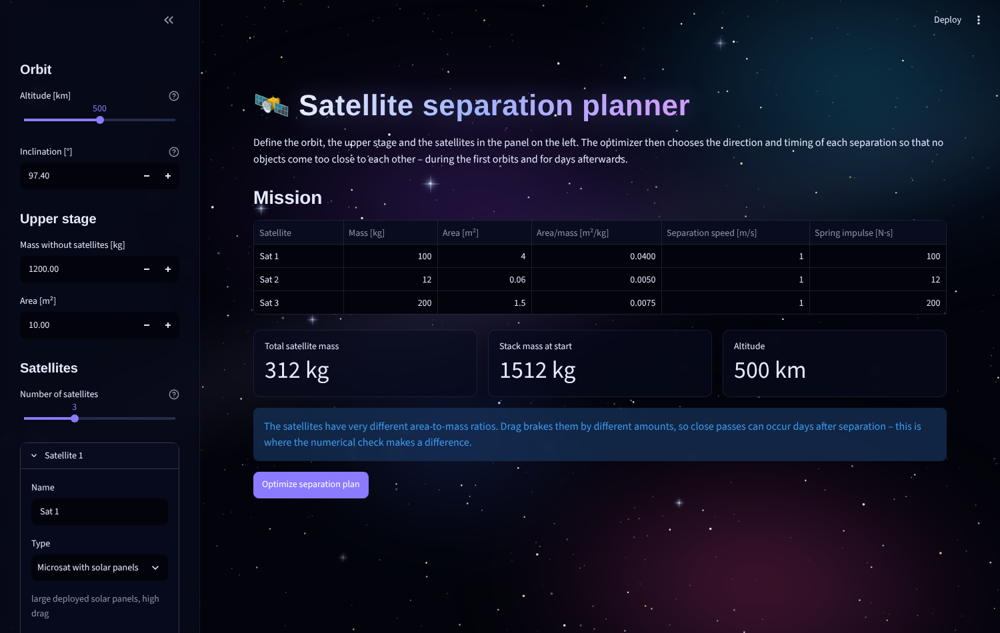

A Streamlit app that turns the library into a planning tool. In the sidebar you
choose the orbit, the upper stage and 2–5 satellites, either from a catalogue of
typical types (3U/6U/12U CubeSats, microsat with solar panels, compact smallsat)
or with your own mass, area and drag coefficient. One click then runs the
two-stage optimization:

1. **CW optimizer** – differential evolution searches separation directions and
   gaps that maximize the closest approach during the first orbits.
2. **Numerical check** – the best candidates are propagated for up to three weeks
   with J2 and drag at low, medium and high solar activity, in parallel on all
   CPU cores, and ranked by their worst case.

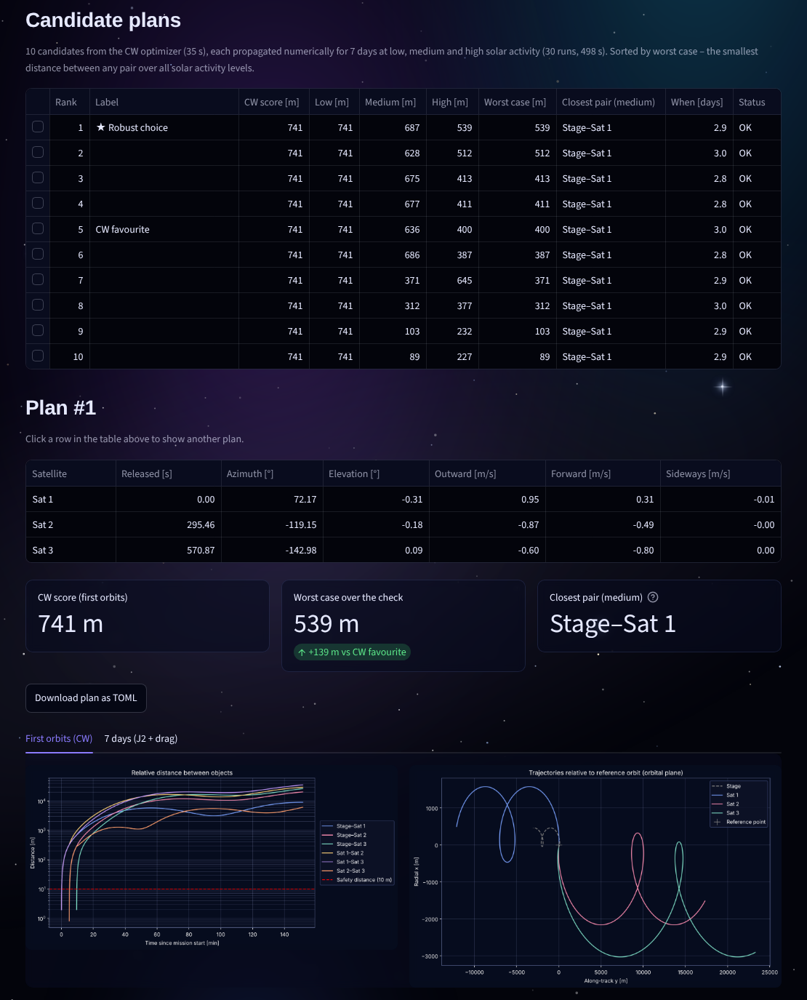

The result is a table of candidate plans. Click a row to see the separation
times and angles, key figures, plots for the first orbits and the whole
numerical check, and to download the plan as a TOML scenario. With the default
inputs (500 km, 1200 kg stage, a 100 kg microsat with 4 m² panels, a 12 kg 6U
CubeSat and a 200 kg compact satellite) the robust choice keeps every pair at
least **539 m** apart over 7 days, against **400 m** for the plan CW alone rates
highest.

```bash
uv run streamlit run app/streamlit_app.py
```

## 3D viewer (v0.6)

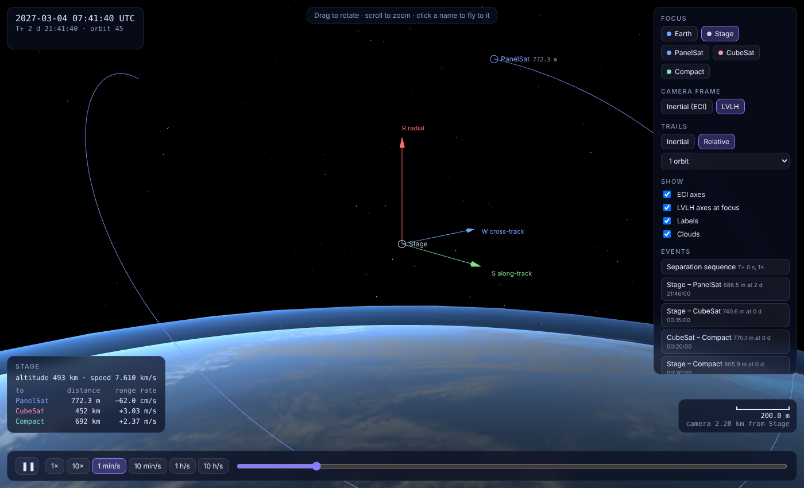

Every plan can be explored on a 3D globe, either in a tab in the app or as a
standalone HTML page. The trajectories come from the numerical model (J2 + drag,
21 days); the page interpolates between 60 s samples with cubic Hermite
interpolation, which keeps the error in the distance *between* two objects
**below 1 cm** (tested against direct propagation every 10 s).

- **Zoom over seven orders of magnitude** – from 26 000 km to under a metre,
  with a scale bar. The upper stage and the satellites are drawn at true size.
- **No jitter at close range** – graphics cards compute in 32-bit floats, which
  at 6 900 km from the Earth's centre resolve only about ±0.5 m. The viewer keeps
  all positions in 64-bit precision relative to the object the camera follows
  (a floating origin) and only sends the small differences to the GPU.
- **Two camera frames** – inertial (ECI, fixed to the stars) and LVLH, which
  rotates with the followed object so that radial is always up.
- **Two kinds of trails** – paths through space, or paths *relative* to the
  followed object in its LVLH frame: the Clohessy–Wiltshire loops, now from the
  full numerical model.
- **Real sky and lighting** – 5 044 stars at their catalogue positions (ECI is
  fixed to the stars), the Earth rotating with Greenwich sidereal time, the Sun at
  its position for the chosen date, day/night terminator, and Earth's shadow.
- **Sun-synchronous geometry** – the orbit plane is set so that the ascending node
  passes at 10:30 local solar time. All forces in the model are symmetric about
  the Earth's axis, so the plane can be rotated after propagation with exactly the
  same result as starting there.
- **Time controls** – play from real time to 10 h per second, scrub over three
  weeks, and jump straight to the separations or the closest passes. A panel shows
  the distance and range rate to every other object.

```bash
uv run python examples/export_3d.py scenarios/scenario3_mixed_robust.toml   # → results/…_3d.html
```

## Headline result: optimized separation plan (v0.3)

Same hardware — 500 km orbit, 1200 kg upper stage, three 150 kg satellites with
150 N·s springs (1 m/s each). The optimizer chooses only the separation
directions and the time between separations.

| Naive plan (scenario 1) | Optimized plan |
|---|---|
| 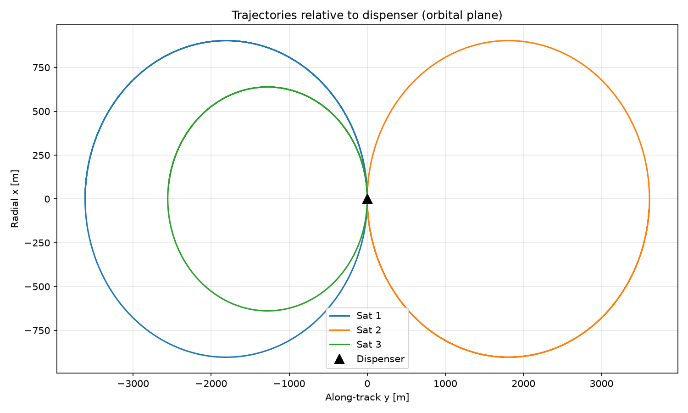 | 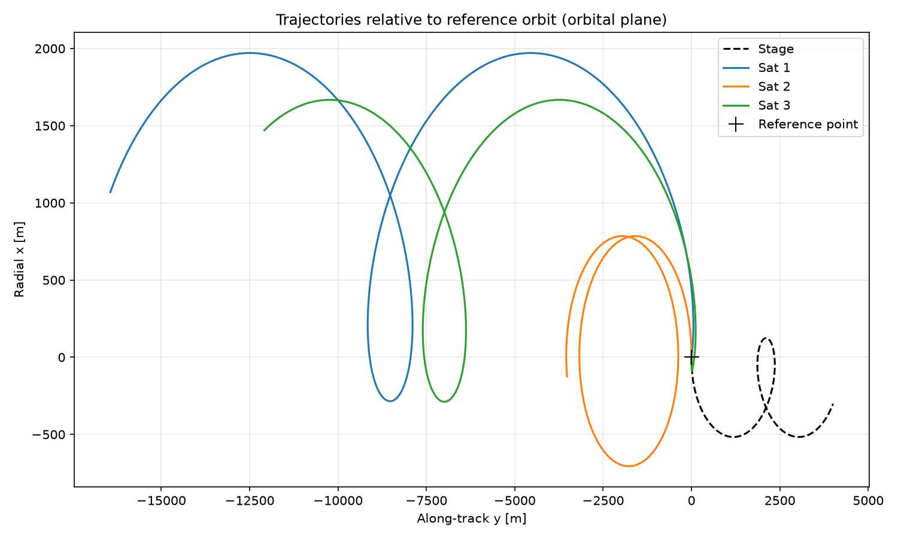 |
| Radial pushes, 60 s apart. All objects return close together after one orbit. **Worst pair: 0.4 m.** | Mostly radial pushes with small, *different* along-track components, ~5 min apart. Nothing returns. **Worst pair: 770 m.** |

**The optimized plan** (`scenarios/scenario1_optimized.toml`), translated to physics:

| Satellite | Released | Outward | Forward | Sideways | Drift behind per orbit |
|---|---|---|---|---|---|
| Sat 1 | 0 s | 0.83 m/s | 0.47 m/s | −0.31 m/s | ≈ 7.9 km |
| Sat 2 | 297 s | 0.93 m/s | 0.07 m/s | +0.36 m/s | ≈ 1.2 km |
| Sat 3 | 580 s | 0.88 m/s | 0.44 m/s | −0.20 m/s | ≈ 7.4 km |

**What the optimizer found:**
- **Mostly outward pushes.** A radial push opens distance fastest in the first
  minutes after separation.
- **A small along-track component that differs between satellites.** It changes
  each satellite's orbital period by a different amount, so they drift apart at
  different rates and never return to each other or to the stage.
- **It uses the recoil.** All satellites are pushed roughly the same way, so the
  three recoils add up and push the stage inward and backward into a lower,
  faster orbit. The stage drifts ≈ 4 km *ahead*, out of the satellites' way.
- **Long gaps between separations** (~290 s, close to the 300 s limit). The
  constraint is active — allowing longer gaps would likely improve the result.
- **Several pairs end up at almost exactly the same distance** (~770 m). This is
  typical of a max-min optimum: the worst pair is improved until another pair
  becomes equally bad, and the plan ends up balanced.

## How long can the CW model be trusted? (v0.4)

The optimizer uses the fast analytic CW model. To check it, the same mission is
propagated numerically around the Earth (ECI frame) with the perturbations CW
leaves out, switched on one at a time. The plot shows the largest error in any
pair distance, CW compared with the numerical model, over three days:

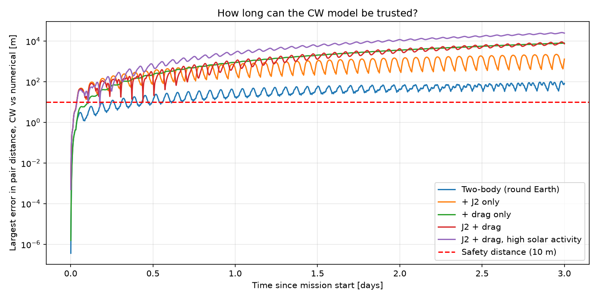

| Numerical model | CW error > 10 m after | Error after 3 days | Minimum distance |
|---|---|---|---|
| Two-body (round Earth) | 5.9 h | 84 m | 781 m |
| + J2 only | 0.9 h | 1.3 km | 781 m |
| + drag only | 2.5 h | 8.1 km | 781 m |
| J2 + drag | 0.9 h | 7.5 km | 781 m |
| J2 + drag, high solar activity | 0.9 h | 25 km | 781 m |
| *CW (reference)* | | | *781 m* |

**Findings:**
- **CW's own linearization error is small.** With a round Earth, the error is
  under 100 m after three days, although the objects are then tens of km apart.
  It grows with the square of the separation, as expected for a linearized model.
- **J2 gives an early, bounded error.** It passes 10 m within an hour, then
  oscillates with the orbital period and grows slowly. A likely contributor is
  that, with J2, the initial circular-orbit velocity gives a slightly eccentric
  orbit, while CW assumes a perfectly circular one.
- **Drag dominates over time.** Objects with different area-to-mass ratios are
  braked by different amounts, and the resulting along-track drift grows with
  time squared: ≈ 8 km after three days, ≈ 25 km at high solar activity.
- **The plan's safety is unaffected.** The minimum distance is the same in all
  models, because it occurs in the first 10–20 minutes after separation, when
  CW is accurate to centimetres. The large errors appear only once the objects
  are already kilometres apart.

**Conclusion:** CW is adequate for planning the separation itself and the first
orbits, which is where the collision risk is. Predicting where the satellites
are after days requires the numerical model, and drag is the dominant effect.
This supports the approach used here: optimize quickly with CW, verify with
the full model.

(Minimum distance is 781 m rather than 770 m because 3 000 samples over three
days give one sample every 86 s, so the minimum is resolved more coarsely.)

## Late encounters that CW cannot see (v0.4.1)

CW knows nothing about air. For satellites with *different* area-to-mass
ratios, differential drag changes their drift over days, and objects that
separated cleanly can come back towards each other. This is tested with a mixed
rideshare (`scenarios/scenario3_mixed.toml`): a 100 kg satellite with large
solar panels (4 m²), a 12 kg 6U CubeSat (0.06 m²) and a compact 200 kg
satellite (1.5 m²), all separated at 1 m/s.

**Two-stage selection:**
1. The CW optimizer returns its 20 best plans for the first orbits (14 s).
2. Each plan is propagated numerically (J2 + drag) for 7 days at low, medium
   and high solar activity — air density is the most uncertain input — in
   parallel on all CPU cores (60 runs, 88 s).
3. The plan with the best **worst case** over all three levels is chosen.

| | CW score | Low | Medium | High | **Worst case** |
|---|---|---|---|---|---|
| CW favourite | 741 m | 741 m | 636 m | 400 m | **400 m** |
| Robust choice | 741 m | 741 m | 671 m | 596 m | **596 m** |
| Worst of the 20 candidates | 741 m | 741 m | 44 m | 37 m | **37 m** |

**Findings:**
- **CW cannot tell the plans apart.** All 20 candidates score 741 m in the CW
  model, yet over a week their worst case ranges from **37 m to 596 m**.
- **The same late encounter occurs in every plan.** About three days after
  separation, the satellite with large solar panels — braked most by the air —
  sinks, speeds up and catches up with the upper stage from behind. At low solar
  activity the drag is too weak for this to happen within a week.
- **Selection changes how close the pass is, not whether it happens.** The
  miss distance depends on where in its relative ellipse the satellite happens
  to be at the moment of the pass, which is sensitive to small differences.
  The robust choice improves the worst case from 400 m to 596 m; at medium
  activity the two plans are almost identical:

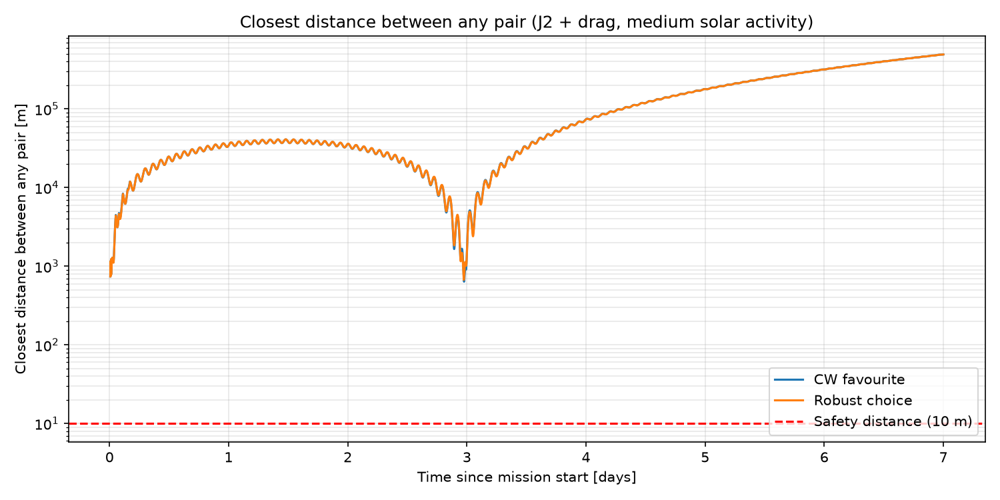

**Conclusion:** the tool finds a risk the simplified model misses, quantifies it
under uncertainty, and picks the plan that does best in the worst case. Avoiding
the encounter altogether would need something beyond separation design — a
different release order or an upper-stage avoidance manoeuvre after deployment,
which is how such encounters are handled in practice.

## Why direction matters (v0.2)

Same orbit (500 km), same upper stage (1200 kg), same satellites (150 kg, spring
impulse 150 N·s → exactly 1 m/s each). Only the separation directions differ.
Upper-stage recoil is included.

| Scenario 1: radial separations | Scenario 2: separations with along-track component |
|---|---|
| 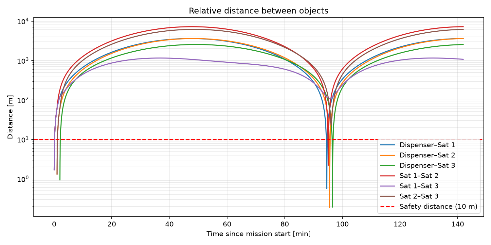 | 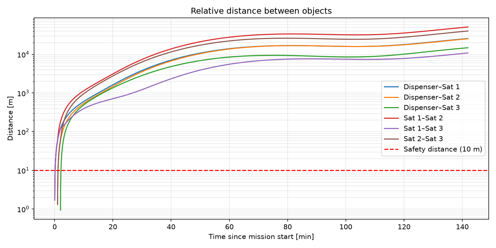 |
|  | 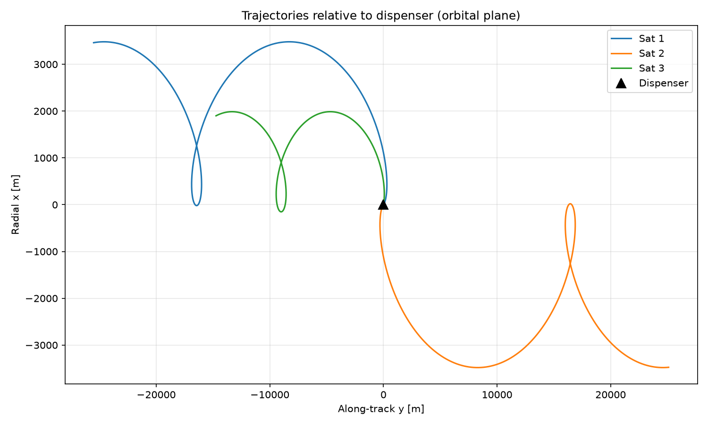 |
| All objects return close to each other after one orbit (~95 min). Minimum distance 0.2 m (stage–Sat 3): **re-contact risk**. | Satellites drift apart along-track and never return. Minimum distance after clearance: **~395 m**. |

The trajectory plots show motion relative to the reference orbit (cross) in the
orbital plane; the upper stage is the dashed line. Radial pushes give closed
ellipses. Along-track pushes change the orbital period, so each satellite
drifts ≈ 17 km per orbit per m/s of along-track velocity.

**Effect of recoil:** in scenario 1, Sat 2 inherits the stage's recoil from the
first separation, so its effective push becomes 1.08 m/s instead of 1.0 m/s
and its ellipse grows. In scenario 2, the stage drifts ≈ 1.6 km from the
reference point after 1.5 orbits — recoil of a few cm/s changes the geometry
by kilometres, which is why it has to be modelled.

Note: the trajectory plots use different scales on the two axes.

## Vision

The end goal is a planning tool:

**Input** — mission and hardware parameters:
```toml
[orbit]
altitude_km = 500

[upper_stage]
mass_kg = 1200

[constraints]
safety_distance_m = 10
min_time_between_separations_s = 30

[[satellites]]
name = "Sat 1"
mass_kg = 150
spring_impulse_Ns = 120     # Δv = J / m
area_m2 = 1.2               # for drag modelling
```

**Output** — a recommended separation plan:
```
Sat 1   t =   0 s   azimuth  12°   elevation  -5°   Δv 0.80 m/s
Sat 2   t =  45 s   azimuth 168°   elevation  10°   Δv 1.50 m/s
Minimum distance (any pair, after clearance): 340 m
Collision probability (Monte Carlo): < 0.01 %
```

plus plots and a 3D visualization of the deployment (global view of the orbit
and a close-up view following the dispenser).

## Status and roadmap

**v0.1 — done**
- [x] Physical constants with sources (WGS84, EGM2008, IAU)
- [x] Clohessy–Wiltshire analytic propagation
- [x] Separation times (satellites released in sequence)
- [x] Pairwise conjunction analysis (minimum distance and time of closest approach)
- [x] Plots: relative distance over time, trajectories in the orbital plane
- [x] Demo scenarios: radial vs. along-track separation
- [x] Validation tests

**v0.2 — done**
- [x] Satellite masses and spring impulse (Δv = J / m)
- [x] Upper-stage recoil from momentum conservation, growing as the stack gets lighter
- [x] Mission propagation with the stage moving (superposition of CW responses)
- [x] Scenarios loaded from TOML files, one generic run script

**v0.3 — done**
- [x] Separation direction as azimuth and elevation
- [x] Clearance time per pair, measured from the later separation in the pair
- [x] Objective function: minimum distance of the worst pair (max-min)
- [x] Optimizer for separation directions and gaps (differential evolution)
- [x] Optimized plan saved as a TOML scenario; shared analysis code for optimizer and run script

**v0.4 — done**
- [x] Coordinate conversions between ECI and LVLH (including the rotating-frame term)
- [x] Force models: two-body gravity, J2, atmospheric drag (exponential atmosphere,
  co-rotating air, solar activity levels), individually switchable
- [x] Numerical propagation of every object in ECI with impulsive separations
- [x] New scenario parameters with defaults: inclination, object areas, drag coefficients
- [x] Comparison of CW against the numerical model, perturbation by perturbation
- [x] Verification that the optimized plan holds in the full model

**v0.4.1 — done**
- [x] Long-term analysis with the numerical model (closest pass over several days)
- [x] Two-stage selection: CW candidates ranked by numerical worst case over solar activity levels
- [x] Parallel evaluation on all CPU cores
- [x] Mixed rideshare scenario (large panels, CubeSat, compact satellite)

**v0.5 — done**
- [x] Streamlit app: orbit, upper stage and 2–5 satellites as inputs
- [x] Satellite catalogue with typical masses, areas and drag coefficients
- [x] Two-stage optimization from the app with progress reporting
- [x] Candidate table with robust choice and CW favourite, clickable plan details
- [x] Plan export as TOML scenario, plots for the first orbits and the numerical check
- [x] End-to-end app test (Streamlit AppTest)

**v0.6 — done**
- [x] Trajectory export: 21 days of numerical states, Earth orientation (GMST), Sun direction
- [x] Orbit plane set from local time of the ascending node (sun-synchronous, 10:30)
- [x] Three.js viewer: textured Earth with day/night and city lights, real stars, Earth's shadow
- [x] Floating origin and Hermite interpolation: zoom from 26 000 km to 1 m without jitter
- [x] Inertial and LVLH camera frames, inertial and relative trails, time controls, event list
- [x] 3D tab in the app and standalone HTML export (live demo on GitHub Pages)
- [x] Fix: saved scenarios now include areas, drag coefficients and inclination

**Planned**
- [ ] v0.6.1 — Launch animation: lift-off, orbit insertion and the separation sequence
- [ ] v0.7 — Monte Carlo collision probability (spring and attitude uncertainty)

**Future work**
- Upper-stage collision avoidance manoeuvre after deployment
- Phasing: choose separations that reduce propellant needed to reach constellation slots
- First ground station contact (e.g. Esrange) after separation

## Model

**Reference frame:** LVLH / Hill frame (RIC), centered on the reference orbit
(where the stack would be without any separations):
- x: radial, outward from Earth
- y: along-track, direction of motion
- z: cross-track, along the orbit normal

**Clohessy–Wiltshire equations** (n = mean motion of the reference orbit):

    ẍ − 3n²x − 2nẏ = 0
    ÿ + 2nẋ = 0
    z̈ + n²z = 0

The closed-form solution is used, so no numerical integration is needed.

**Separation physics:** each spring delivers an impulse J between the satellite
and the remaining stack (upper stage + satellites not yet released). Momentum
is conserved:

    Δv_sat   = +J / m_sat  · d̂
    Δv_stack = −J / m_rest · d̂

The stack gets lighter with every separation, so the recoil grows.

**Mission propagation:** because the CW equations are linear, motion from
several impulses is the sum of the motion from each impulse alone. The stage
trajectory is the sum of all recoils; a satellite inherits the recoils from
satellites released before it, plus its own push from its separation time.

**Conjunction analysis:** distances are computed between all pairs of objects
(upper stage included) at every sample time. For each pair, the minimum distance
is evaluated from a clearance time (default 600 s) after the *later* of the two
separations, so that the proximity right after a separation is not counted as a
collision — even when a satellite is released late in the sequence.

**Optimization:** a plan is described by two angles per satellite and the gap
between consecutive separations:

    [az_1, el_1, ..., az_n, el_n, gap_2, ..., gap_n]

- Azimuth: angle in the orbital plane from along-track (0° forward, 90° outward)
- Elevation: angle out of the orbital plane (90° cross-track)
- Gaps between separations are bounded (default 30–300 s); the release order
  is the order in the scenario file

Masses and spring impulses are fixed by the hardware. The objective is to
**maximize the minimum distance of the worst pair** — an average would hide a
single dangerous pair.

The objective is non-smooth (the worst pair switches), has jumps (sampled times,
clearance windows) and many local optima (satellites can swap roles), so a
gradient-based method is a poor fit. `scipy.optimize.differential_evolution` is
used instead: derivative-free and global, at the cost of many evaluations
(~18 000 plans, ~30 s), which the fast analytic CW model makes affordable.

**Numerical model (v0.4):** every object is propagated in the Earth-centred
inertial frame (ECI) with Newton's second law, integrated with
`scipy.integrate.solve_ivp` (DOP853, relative tolerance 10⁻¹²; high precision is
needed to resolve metres at 6 878 km from the Earth's centre). Accelerations:

| Force | Model | Magnitude at 500 km |
|---|---|---|
| Gravity | −μ r / \|r\|³ | 8.4 m/s² |
| J2 (Earth's oblateness) | standard zonal J2 term | ≈ 0.012 m/s² |
| Drag | −½ ρ (C_d A / m) \|v_rel\| v_rel, atmosphere co-rotating with the Earth | ≈ 10⁻⁷–10⁻⁶ m/s² |

Air density uses an exponential model around 500 km (Vallado), scaled by an
approximate factor for low/medium/high solar activity. Separations are applied
as instantaneous velocity changes in the stack's LVLH frame at the moment of
separation. Results are converted to LVLH relative to a reference point
propagated with the same gravity model (without drag), so that all analysis and
plotting code is shared with the CW model.

Because only *differences* between objects affect relative motion, J2 — about
10 000 times stronger than drag — has a smaller long-term effect than drag:
J2 acts almost equally on objects close together, while drag depends on each
object's area-to-mass ratio.

**Assumptions and limitations:**
- CW model: circular reference orbit, relative distances small compared to
  orbit radius, no perturbations (quantified against the numerical model above)
- Numerical model: simple exponential atmosphere with a rough solar activity
  factor (no real-time solar indices); no solar radiation pressure, third-body
  gravity or higher-order gravity terms (J3, J4, …); constant drag coefficient
  and cross-section (no attitude-dependent area)
- Separations are instantaneous impulses (no spring stroke duration, no tip-off rotation)
- Point masses: attitude and physical size of the objects are not modelled
- Closest approach is found among sampled times only; the true minimum may lie
  between samples (default ~1.7 s spacing)
- Results are only valid within the simulated time window (1.5 orbits after
  the last separation)
- For most pairs in the optimized plan, the minimum occurs right when the
  clearance time ends. The score therefore mainly measures how fast objects
  separate, plus that none return — the choice of clearance time affects the result
- Release order is fixed; only directions and gaps are optimized
- All directions are allowed; real dispensers restrict which directions are
  physically possible
- All units SI (m, s, kg)

## Validation

| Test | Expected result |
|---|---|
| Orbital period at 500 km | ≈ 94.6 min |
| Radial push, 1 m/s | Returns to origin after one orbit |
| Along-track push, 1 m/s | Drifts 6π/n ≈ 17 km *behind* after one orbit |
| Cross-track push | Pure oscillation in z, no coupling to x/y |
| Identical separations | Zero distance between the two satellites at all times |
| Radial push, conjunction analysis | Re-contact with dispenser detected at t ≈ one orbit |
| Along-track push, conjunction analysis | No return to the dispenser after clearance |
| Delayed separation | Same trajectory as immediate separation, shifted in time |
| Separation state from direction + speed | Requested speed and direction, starting at the dispenser |
| Momentum at each separation | m_sat · Δv_sat + m_rest · Δv_stack = 0 |
| Recoil vs. stack mass | Recoil grows as satellites are released (J/1500 → J/1200 kg) |
| Very heavy stage (10¹² kg) | Same trajectories as v0.1 (stage stays at origin) |
| Centre of mass of all objects | Stays at the reference point at all times (internal forces only) |
| Satellite before its separation | Identical state to the upper stage |
| Scenario loading | TOML values parsed correctly, km converted to m |
| Direction from angles | 0° → forward, 90° → outward, 180° → backward, elevation 90° → cross-track; always unit length |
| Late separation | Not reported as a collision with per-pair clearance (would be with a single clearance time) |
| Plan parameters | Angles and gaps mapped to directions and separation times; masses unchanged; original mission not modified |
| Objective | Scenario 1 scored as unsafe (< 10 m), scenario 2 as safe (> 100 m) |
| Optimizer | Beats the naive plan; reported score matches re-evaluation of the returned plan |
| Circular orbit state | Correct position, speed √(μ/r), velocity perpendicular to position |
| LVLH basis | Proper rotation matrix (orthonormal, right-handed); forward = velocity direction |
| ECI ↔ LVLH | Round trip returns the input; 1 km outward at rest in LVLH = n · 1000 m/s faster in ECI |
| Gravity and J2 | μ/r² towards the centre; J2 inward at the equator, outward over the pole, ≈ 10⁻³ of gravity |
| Drag | Opposes motion; density falls with altitude and rises with solar activity |
| Two-body integration | Circular orbit stays circular; energy conserved to 10⁻¹⁰ |
| Numerical vs. CW | Agree within 5 cm for small separations; CW error grows with the square of the separation |
| Differential drag | A light object with large area ends up *ahead* of a compact stage after one day |
| Long-term analysis | Agrees with the CW objective over short times without perturbations |
| Greenwich sidereal time | 280.46061837° at J2000 (2000-01-01 12:00 UT1) |
| Sun direction | Along the ECI x-axis at the March equinox 2027 (within 0.05°) |
| Rotation about the Earth's axis | Rotating the start state then propagating = propagating then rotating (< 1 mm after 1 day, J2 + drag) |
| Hermite interpolation of 60 s samples | Absolute error < 1 m, error in distance between objects < 1 cm |
| 3D viewer page | Data embedded and round-trips; object names cannot break out of the script tag |
| Robust ranking | Worst case is the smallest of the CW score and all solar levels; candidates sorted by it |

## Getting started

Requires [uv](https://docs.astral.sh/uv/).

```bash
uv sync
uv run pytest                                                 # run all tests (~1 min)
uv run streamlit run app/streamlit_app.py                     # the planner app
uv run python examples/export_3d.py scenarios/scenario3_mixed_robust.toml   # standalone 3D page
```

The examples run the same analyses from the command line:

```bash
uv run python examples/run_scenario.py scenarios/scenario1.toml   # radial separations
uv run python examples/run_scenario.py scenarios/scenario2.toml   # along-track separations

# Optimize the separation plan for the satellites in scenario 1 (~30 s)
uv run python examples/optimize_scenario.py scenarios/scenario1.toml
uv run python examples/run_scenario.py scenarios/scenario1_optimized.toml

# Compare CW with the numerical model over 3 days (~1 min)
uv run python examples/compare_models.py scenarios/scenario1_optimized.toml 3

# Two-stage robust optimization: CW candidates + 7-day numerical check (~2 min)
uv run python examples/optimize_robust.py scenarios/scenario3_mixed.toml
```

Figures are written to `results/`. The optimizer uses the hardware in the
scenario file (masses, springs, stage mass, release order) and writes the best
plan to `scenarios/<name>_optimized.toml`.

To create a new scenario, copy a TOML file in `scenarios/` and change the
values – no code changes needed (optional parameters with defaults in brackets):

```toml
name = "Scenario 1: radial separations"
altitude_km = 500
stage_mass_kg = 1200
inclination_deg = 97.4          # [97.4] sun-synchronous at 500 km
stage_area_m2 = 10.0            # [10.0]
stage_drag_coefficient = 2.2    # [2.2]

[[satellites]]
name = "Sat 1"
mass_kg = 150
spring_impulse_Ns = 150
direction = [1, 0, 0]           # LVLH: radial, along-track, cross-track
t_sep_s = 0
area_m2 = 1.0                   # [1.0]
drag_coefficient = 2.2          # [2.2]
```

## Project structure

```
app/
└── streamlit_app.py        # the planner app
.streamlit/config.toml      # dark theme for the app
src/sepsim/
├── constants.py            # physical constants with sources
├── scenario.py             # Satellite and Mission data classes, TOML loading and saving
├── catalog.py              # satellite types and app inputs → Mission
├── export.py               # trajectories, Earth rotation and Sun for the 3D viewer
├── optimize.py             # plan parameters, objective, optimizer
├── dynamics/
│   ├── cw.py               # Clohessy–Wiltshire propagation, separation times
│   ├── separation.py       # separation kicks with recoil, mission propagation, angles
│   ├── frames.py           # ECI ↔ LVLH conversions
│   ├── forces.py           # gravity, J2, atmospheric drag
│   └── propagator.py       # numerical propagation of a whole mission
├── analysis/
│   ├── conjunctions.py     # pairwise distances, closest approach (per-pair clearance)
│   ├── mission.py          # shared mission analysis used by optimizer and run script
│   └── long_term.py        # multi-day numerical analysis, robust ranking
└── viz/
    ├── plots.py            # distance and trajectory plots
    ├── space_theme.py      # starry background and dark plot style for the app
    ├── viewer.py           # builds the standalone 3D page from exported data
    └── viewer.html         # the 3D viewer (Three.js)
scenarios/
├── scenario1.toml              # radial separations
├── scenario2.toml              # separations with along-track component
├── scenario1_optimized.toml    # optimized plan for the scenario 1 hardware
├── scenario3_mixed.toml        # mixed rideshare: large panels, CubeSat, compact
├── scenario3_mixed_optimized.toml  # CW favourite for scenario 3
└── scenario3_mixed_robust.toml     # robust choice for scenario 3
examples/
├── run_scenario.py         # analyse any scenario: simulation, analysis, plots
├── optimize_scenario.py    # optimize a plan and save it as a scenario
├── compare_models.py       # CW vs numerical model, perturbation by perturbation
├── optimize_robust.py      # two-stage optimization: CW candidates + numerical worst case
└── export_3d.py            # standalone 3D page for a scenario
tests/
├── test_constants.py
├── test_cw.py
├── test_conjunctions.py
├── test_clearance.py
├── test_separation.py
├── test_propagate_mission.py
├── test_scenario.py
├── test_optimize.py
├── test_frames.py
├── test_forces.py
├── test_propagator.py
├── test_long_term.py
├── test_catalog.py
├── test_export.py
├── test_viewer.py
└── test_app.py             # runs the app end to end with Streamlit AppTest
docs/
├── index.html              # live 3D demo served by GitHub Pages
└── images/                 # figures used in this README
```

## References

- Clohessy, W. H. & Wiltshire, R. S. (1960). *Terminal Guidance System for
  Satellite Rendezvous.* Journal of the Aerospace Sciences, 27(9).
- Curtis, H. D. (2014). *Orbital Mechanics for Engineering Students* (3rd ed.).
- Vallado, D. A. *Fundamentals of Astrodynamics and Applications.*
- NIMA (2000). *WGS84 — Department of Defense World Geodetic System 1984.*