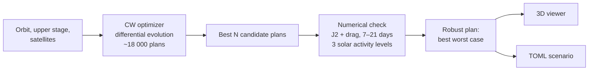

# sepsim — Satellite Separation Simulator

A planning tool for multi-satellite deployments. Given an orbit, an upper stage
and a set of satellites, it chooses **when and in which direction each satellite
is released** so that no two objects – satellites or upper stage – come close to
each other, during the first orbits and for weeks afterwards.

**[▶ Live 3D demo](https://sebastianljungblad.github.io/sat-separation-sim/)** – a
separation plan for three satellites, propagated for 21 days with J2 and drag.
Rotate the Earth, zoom from 26 000 km down to the satellites at true scale, and
replay the closest passes.


## Key results

- **Direction decides everything.** Three satellites pushed straight outward at
  1 m/s all return to within **0.4 m** of each other after one orbit. The
  optimizer finds directions and timing that keep every pair at least **770 m**
  apart with the same springs.
- **The fast model is right where it matters.** The analytic Clohessy–Wiltshire
  (CW) model is accurate to centimetres during the first 20 minutes, when the
  closest approaches happen – but over days, drag makes it drift by **8–25 km**.
- **A risk the fast model cannot see.** For a mixed rideshare, all 20 best CW
  plans score the same 741 m. Propagated numerically for a week, their worst
  case ranges from **37 m to 596 m**: a satellite with large solar panels is
  braked by the air and catches up with the upper stage about three days later.
  Two-stage selection picks the plan that holds up in the worst case.
- **True scale in 3D.** The viewer zooms over seven orders of magnitude with an
  error **below 1 cm** in the distance between objects.

## How it works



1. **Search fast.** The CW equations describe motion relative to a circular
   orbit in closed form, so a plan can be evaluated in milliseconds. A global
   optimizer searches separation directions and gaps that maximize the closest
   approach of the worst pair.
2. **Check thoroughly.** The best candidates are propagated numerically around
   the Earth with J2 (the Earth's oblateness) and atmospheric drag, at low,
   medium and high solar activity, in parallel on all CPU cores.
3. **Choose robustly.** The plan with the best worst case over all solar
   activity levels wins – air density is the most uncertain input.

## The planner app


```bash
uv run streamlit run app/streamlit_app.py
```

Choose the orbit, the upper stage and 2–5 satellites in the sidebar, either from
a catalogue (3U/6U/12U CubeSats, microsat with solar panels, compact smallsat)
or with your own mass, area and drag coefficient. One click runs the whole
pipeline with a progress bar. The result is a table of candidate plans; click a
row to see separation times and angles, plots, the 3D view, and to download the
plan as a TOML scenario.

## 3D viewer


Available as a tab in the app or as a standalone page
(`uv run python examples/export_3d.py <scenario.toml>`).

- **Seven orders of magnitude of zoom** – from 26 000 km to under a metre, with
  a scale bar. The upper stage and the satellites are drawn at true size.
- **No jitter at close range** – graphics cards compute in 32-bit floats, which
  at 6 900 km from the Earth's centre resolve only about ±0.5 m. The viewer keeps
  all positions in 64-bit precision relative to the object the camera follows
  (a *floating origin*) and sends only the small differences to the GPU.
- **Exact between samples** – the trajectories come from the numerical model;
  the viewer interpolates between 60 s samples with cubic Hermite interpolation.
  Tested against direct propagation: error in the distance between two objects
  below 1 cm.
- **Two camera frames and two kinds of trails** – inertial (fixed to the stars)
  or LVLH (rotating with the followed object, radial always up); paths through
  space, or paths *relative* to the followed object – the CW loops, now from the
  full numerical model.
- **Real sky and lighting** – 5 044 stars at their catalogue positions, the
  Earth rotating with Greenwich sidereal time, the Sun at its position for the
  chosen date, day/night and Earth's shadow. The orbit plane is set for a
  sun-synchronous orbit with the ascending node at 10:30 local time.
- **Time controls** – real time to 10 h per second over three weeks, a list of
  the separations and closest passes to jump to, and live distance and range
  rate to every other object.

## Results

### 1. Why separation direction matters

Same orbit (500 km), upper stage (1200 kg) and satellites (150 kg, spring
impulse 150 N·s → exactly 1 m/s each). Only the separation directions differ.
Upper-stage recoil is included.

| Scenario 1: radial separations | Scenario 2: separations with along-track component |
|---|---|
|  |  |
|  |  |
| All objects return close to each other after one orbit (~95 min). Minimum distance 0.2 m (stage–Sat 3): **re-contact risk**. | Satellites drift apart along-track and never return. Minimum distance after clearance: **~395 m**. |

The trajectory plots show motion relative to the reference orbit (cross) in the
orbital plane; the upper stage is the dashed line. Note the different scales on
the two axes.

- **Radial pushes give closed ellipses** – the satellite is back where it
  started after one orbit.
- **Along-track pushes change the orbital period.** A satellite pushed forward
  climbs into a higher, slower orbit and ends up *behind*: ≈ 17 km per orbit per
  m/s of along-track velocity.
- **Recoil matters.** In scenario 1, Sat 2 inherits the stage's recoil from the
  first separation, so its effective push becomes 1.08 m/s. In scenario 2 the
  stage drifts ≈ 1.6 km in 1.5 orbits – a few cm/s of recoil changes the
  geometry by kilometres.

### 2. Optimizing the separation plan

The optimizer keeps the hardware (masses, springs, release order) and chooses
only the separation directions and the time between separations.

| Naive plan (scenario 1) | Optimized plan |
|---|---|
|  |  |
| Radial pushes, 60 s apart. All objects return after one orbit. **Worst pair: 0.4 m.** | Mostly radial pushes with small, *different* along-track components, ~5 min apart. Nothing returns. **Worst pair: 770 m.** |

| Satellite | Released | Outward | Forward | Sideways | Drift behind per orbit |
|---|---|---|---|---|---|
| Sat 1 | 0 s | 0.83 m/s | 0.47 m/s | −0.31 m/s | ≈ 7.9 km |
| Sat 2 | 297 s | 0.93 m/s | 0.07 m/s | +0.36 m/s | ≈ 1.2 km |
| Sat 3 | 580 s | 0.88 m/s | 0.44 m/s | −0.20 m/s | ≈ 7.4 km |

**What the optimizer found:**
- **Mostly outward pushes** – they open distance fastest in the first minutes.
- **Small along-track components that differ between satellites** – each
  satellite gets a different orbital period, so they drift apart at different
  rates and never return.
- **It uses the recoil** – the three recoils add up and push the stage into a
  lower, faster orbit, so it drifts ≈ 4 km *ahead*, out of the way.
- **Long gaps** (~290 s, close to the 300 s limit) – the constraint is active;
  longer gaps would likely help.
- **Several pairs at almost the same distance** (~770 m) – typical of a max-min
  optimum: the worst pair is improved until another pair becomes equally bad.

### 3. How long can the CW model be trusted?

The optimized plan is propagated numerically with the perturbations CW leaves
out, switched on one at a time. The plot shows the largest error in any pair
distance over three days:


| Numerical model | CW error > 10 m after | Error after 3 days | Minimum distance |
|---|---|---|---|
| Two-body (round Earth) | 5.9 h | 84 m | 781 m |
| + J2 only | 0.9 h | 1.3 km | 781 m |
| + drag only | 2.5 h | 8.1 km | 781 m |
| J2 + drag | 0.9 h | 7.5 km | 781 m |
| J2 + drag, high solar activity | 0.9 h | 25 km | 781 m |
| *CW (reference)* | | | *781 m* |

- **CW's own linearization error is small** – under 100 m after three days with
  a round Earth, growing with the square of the separation.
- **J2 gives an early, bounded error** that oscillates with the orbital period.
- **Drag dominates over time** – objects with different area-to-mass ratios are
  braked differently, and the drift grows with time squared.
- **The plan's safety is unaffected** – the closest approach happens in the
  first 10–20 minutes, when CW is accurate to centimetres.

**Conclusion:** CW is good enough to plan the separation itself; predicting
where the objects are after days needs the numerical model. Hence: optimize
with CW, verify numerically. (781 m instead of 770 m because 3 000 samples over
three days resolve the minimum more coarsely.)

### 4. Late encounters that CW cannot see

CW knows nothing about air. When satellites have *different* area-to-mass
ratios, differential drag changes their drift over days, and objects that
separated cleanly can come back towards each other. Test case: a mixed rideshare
(`scenarios/scenario3_mixed.toml`) with a 100 kg satellite with large solar
panels (4 m²), a 12 kg 6U CubeSat (0.06 m²) and a compact 200 kg satellite
(1.5 m²), all separated at 1 m/s.

The CW optimizer returns its 20 best plans (14 s); each is propagated for 7 days
at three solar activity levels (60 runs, 88 s on all cores):

| | CW score | Low | Medium | High | **Worst case** |
|---|---|---|---|---|---|
| CW favourite | 741 m | 741 m | 636 m | 400 m | **400 m** |
| Robust choice | 741 m | 741 m | 671 m | 596 m | **596 m** |
| Worst of the 20 candidates | 741 m | 741 m | 44 m | 37 m | **37 m** |


- **CW cannot tell the plans apart** – all 20 score 741 m, yet their worst case
  over a week ranges from 37 m to 596 m.
- **The same late encounter occurs in every plan** – about three days after
  separation, the satellite with large panels sinks, speeds up and catches up
  with the upper stage from behind. At low solar activity the drag is too weak
  for this to happen within a week.
- **Selection changes how close the pass is, not whether it happens** – the miss
  distance depends on where in its relative ellipse the satellite is at the
  moment of the pass, which is sensitive to small differences.

**Conclusion:** the tool finds a risk the simplified model misses, quantifies
it under uncertainty and picks the plan that does best in the worst case.
Avoiding the encounter altogether would need a different release order or an
upper-stage avoidance manoeuvre after deployment. (The app checks 10 candidates
by default and finds 539 m with the same hardware; checking 20 finds the 596 m
plan.)

## Model

**Frames.** *LVLH* (Hill/RIC) follows the reference orbit: x radial outward,
y along-track, z cross-track. *ECI* is Earth-centred and fixed to the stars;
the numerical model works there.

**Clohessy–Wiltshire equations** (n = mean motion of the reference orbit), solved
in closed form:

    ẍ − 3n²x − 2nẏ = 0
    ÿ + 2nẋ = 0
    z̈ + n²z = 0

**Separation physics.** Each spring delivers an impulse J between the satellite
and the remaining stack (upper stage + satellites not yet released). Momentum is
conserved, so the recoil grows as the stack gets lighter:

    Δv_sat   = +J / m_sat  · d̂
    Δv_stack = −J / m_rest · d̂

Because the CW equations are linear, the motion from several impulses is the sum
of the motion from each: the stage moves with the sum of all recoils, and each
satellite inherits the recoils from the satellites released before it.

**Numerical model.** Every object is propagated in ECI with
`scipy.integrate.solve_ivp` (DOP853, relative tolerance 10⁻¹², needed to resolve
metres at 6 878 km from the Earth's centre):

| Force | Model | Magnitude at 500 km |
|---|---|---|
| Gravity | −μ r / \|r\|³ | 8.4 m/s² |
| J2 (Earth's oblateness) | standard zonal J2 term | ≈ 0.012 m/s² |
| Drag | −½ ρ (C_d A / m) \|v_rel\| v_rel, atmosphere co-rotating with the Earth | ≈ 10⁻⁷–10⁻⁶ m/s² |

Air density uses an exponential model around 500 km (Vallado), scaled for
low/medium/high solar activity. Separations are instantaneous velocity changes
in the stack's LVLH frame. J2 is 10 000 times stronger than drag but acts almost
equally on objects close together; drag depends on each object's area-to-mass
ratio, so it dominates the *relative* motion over days.

**Conjunction analysis.** Distances between all pairs, upper stage included. For
each pair the minimum is evaluated from a clearance time (default 600 s) after
the *later* of the two separations, so the proximity right after a separation is
not counted as a collision.

**Optimization.** A plan is two angles per satellite plus the gaps between
separations, `[az_1, el_1, …, az_n, el_n, gap_2, …, gap_n]` (azimuth in the
orbital plane from along-track, elevation out of it). The objective is to
**maximize the minimum distance of the worst pair** – an average would hide a
single dangerous pair. It is non-smooth, has jumps and many local optima, so
`scipy.optimize.differential_evolution` (global, derivative-free) is used
instead of a gradient method; the fast CW model makes its ~18 000 evaluations
affordable (~30 s).

### Assumptions and limitations

- **CW model:** circular reference orbit, separations small compared to the
  orbit radius, no perturbations – quantified against the numerical model above.
- **Numerical model:** simple exponential atmosphere with a rough solar activity
  factor (no real solar indices); no solar radiation pressure, third-body
  gravity or higher gravity terms (J3, J4, …); constant drag area (no attitude).
- **Separations** are instantaneous impulses (no spring stroke, no tip-off
  rotation), and every direction is allowed – real dispensers restrict this.
- **Release order is fixed;** only directions and gaps are optimized.
- **Sampling:** closest approaches are found among sampled times (≈ 2 s in the
  CW analysis, ≈ 50 s in the 7-day numerical check), so a fast pass between
  samples can be resolved too coarsely.
- **Time windows:** the CW objective covers 1.5 orbits after the last
  separation, the numerical check 7 days (3–21 in the app).
- **Clearance time:** for most pairs the minimum occurs right when the clearance
  time ends, so the score mainly measures how fast objects separate, and its
  choice affects the result.
- **Sensitivity:** the miss distance of late passes depends strongly on small
  differences in separation velocity – the motivation for Monte Carlo analysis
  (planned).

## Getting started

Requires [uv](https://docs.astral.sh/uv/).

```bash
uv sync
uv run pytest                                  # all tests (~1 min)
uv run streamlit run app/streamlit_app.py      # the planner app
```

The same analyses from the command line (figures are written to `results/`):

```bash
uv run python examples/run_scenario.py scenarios/scenario1.toml               # simulate and plot a scenario
uv run python examples/optimize_scenario.py scenarios/scenario1.toml          # CW optimization (~30 s)
uv run python examples/compare_models.py scenarios/scenario1_optimized.toml 3 # CW vs numerical, 3 days
uv run python examples/optimize_robust.py scenarios/scenario3_mixed.toml      # two-stage optimization (~2 min)
uv run python examples/export_3d.py scenarios/scenario3_mixed_robust.toml     # standalone 3D page
```

To create a scenario, copy a TOML file in `scenarios/` and change the values
(optional parameters with defaults in brackets):

```toml
name = "Scenario 1: radial separations"
altitude_km = 500
stage_mass_kg = 1200
inclination_deg = 97.4          # [97.4] sun-synchronous at 500 km
stage_area_m2 = 10.0            # [10.0]
stage_drag_coefficient = 2.2    # [2.2]

[[satellites]]
name = "Sat 1"
mass_kg = 150
spring_impulse_Ns = 150
direction = [1, 0, 0]           # LVLH: radial, along-track, cross-track
t_sep_s = 0
area_m2 = 1.0                   # [1.0]
drag_coefficient = 2.2          # [2.2]
```

## Project structure

```
app/
└── streamlit_app.py        # the planner app
src/sepsim/
├── constants.py            # physical constants with sources
├── scenario.py             # Satellite and Mission data classes, TOML loading and saving
├── catalog.py              # satellite types and app inputs → Mission
├── optimize.py             # plan parameters, objective, optimizer
├── export.py               # trajectories, Earth rotation and Sun for the 3D viewer
├── dynamics/
│   ├── cw.py               # Clohessy–Wiltshire propagation
│   ├── separation.py       # separation kicks with recoil, mission propagation, angles
│   ├── frames.py           # ECI ↔ LVLH conversions
│   ├── forces.py           # gravity, J2, atmospheric drag
│   └── propagator.py       # numerical propagation of a whole mission
├── analysis/
│   ├── conjunctions.py     # pairwise distances, closest approach
│   ├── mission.py          # shared mission analysis (CW)
│   └── long_term.py        # multi-day numerical analysis, robust ranking
└── viz/
    ├── plots.py            # distance and trajectory plots
    ├── space_theme.py      # background and plot style for the app
    ├── viewer.py           # builds the standalone 3D page
    └── viewer.html         # the 3D viewer (Three.js)
scenarios/                  # TOML scenarios: 1 radial, 2 along-track, 3 mixed rideshare, optimized plans
examples/                   # command-line scripts (see Getting started)
tests/                      # 61 tests, one file per module, plus an end-to-end app test
docs/                       # live demo (index.html) and README figures
```

## Validation

<details>
<summary>37 checks against known physics and expected behaviour (click to expand)</summary>

| Test | Expected result |
|---|---|
| Orbital period at 500 km | ≈ 94.6 min |
| Radial push, 1 m/s | Returns to origin after one orbit |
| Along-track push, 1 m/s | Drifts 6π/n ≈ 17 km *behind* after one orbit |
| Cross-track push | Pure oscillation in z, no coupling to x/y |
| Identical separations | Zero distance between the two satellites at all times |
| Radial push, conjunction analysis | Re-contact with dispenser detected at t ≈ one orbit |
| Along-track push, conjunction analysis | No return to the dispenser after clearance |
| Delayed separation | Same trajectory as immediate separation, shifted in time |
| Separation state from direction + speed | Requested speed and direction, starting at the dispenser |
| Momentum at each separation | m_sat · Δv_sat + m_rest · Δv_stack = 0 |
| Recoil vs. stack mass | Recoil grows as satellites are released (J/1500 → J/1200 kg) |
| Very heavy stage (10¹² kg) | Stage stays at the origin |
| Centre of mass of all objects | Stays at the reference point at all times (internal forces only) |
| Satellite before its separation | Identical state to the upper stage |
| Scenario loading | TOML values parsed correctly, km converted to m |
| Direction from angles | 0° → forward, 90° → outward, 180° → backward, elevation 90° → cross-track; always unit length |
| Late separation | Not reported as a collision with per-pair clearance (would be with a single clearance time) |
| Plan parameters | Angles and gaps mapped to directions and separation times; masses unchanged; original mission not modified |
| Objective | Scenario 1 scored as unsafe (< 10 m), scenario 2 as safe (> 100 m) |
| Optimizer | Beats the naive plan; reported score matches re-evaluation of the returned plan |
| Circular orbit state | Correct position, speed √(μ/r), velocity perpendicular to position |
| LVLH basis | Proper rotation matrix (orthonormal, right-handed); forward = velocity direction |
| ECI ↔ LVLH | Round trip returns the input; 1 km outward at rest in LVLH = n · 1000 m/s faster in ECI |
| Gravity and J2 | μ/r² towards the centre; J2 inward at the equator, outward over the pole, ≈ 10⁻³ of gravity |
| Drag | Opposes motion; density falls with altitude and rises with solar activity |
| Two-body integration | Circular orbit stays circular; energy conserved to 10⁻¹⁰ |
| Numerical vs. CW | Agree within 5 cm for small separations; CW error grows with the square of the separation |
| Differential drag | A light object with large area ends up *ahead* of a compact stage after one day |
| Long-term analysis | Agrees with the CW objective over short times without perturbations |
| Robust ranking | Worst case is the smallest of the CW score and all solar levels; candidates sorted by it |
| Satellite catalogue | Types fill in mass, area and drag coefficient; spring impulse = mass × separation speed |
| App | Runs end to end: optimization, candidate table, plan details |
| Greenwich sidereal time | 280.46061837° at J2000 (2000-01-01 12:00 UT1) |
| Sun direction | Along the ECI x-axis at the March equinox 2027 (within 0.05°) |
| Rotation about the Earth's axis | Rotating the start state then propagating = propagating then rotating (< 1 mm after 1 day, J2 + drag) |
| Hermite interpolation of 60 s samples | Absolute error < 1 m, error in distance between objects < 1 cm |
| 3D viewer page | Data embedded and round-trips; object names cannot break out of the script tag |

</details>

## Roadmap

**Next**
- Launch animation in the 3D viewer: lift-off, orbit insertion and the separation sequence
- Monte Carlo collision probability: uncertainty in spring speed and direction

**Future work**
- Optimize the release order, not only directions and gaps
- Upper-stage collision avoidance manoeuvre after deployment
- Phasing: separations that reduce the propellant needed to reach constellation slots
- First ground station contact (e.g. Esrange) after separation

<details>
<summary>Development history</summary>

- **v0.1** – Clohessy–Wiltshire propagation, sequential separations, pairwise conjunction analysis, plots, validation tests
- **v0.2** – Satellite masses and spring impulses, upper-stage recoil, scenarios from TOML files
- **v0.3** – Separation directions as angles, per-pair clearance, max-min objective, differential evolution optimizer
- **v0.4** – ECI ↔ LVLH conversions, J2 and drag, numerical propagation, CW vs numerical comparison
- **v0.4.1** – Multi-day numerical analysis, two-stage robust selection over solar activity, parallel evaluation
- **v0.5** – Streamlit planner app with satellite catalogue, progress reporting and plan details
- **v0.6** – 3D viewer (Three.js) with floating origin, real stars and sunlight; live demo on GitHub Pages

</details>

## References

- Clohessy, W. H. & Wiltshire, R. S. (1960). *Terminal Guidance System for
  Satellite Rendezvous.* Journal of the Aerospace Sciences, 27(9).
- Curtis, H. D. (2014). *Orbital Mechanics for Engineering Students* (3rd ed.).
- Vallado, D. A. *Fundamentals of Astrodynamics and Applications.*
- NIMA (2000). *WGS84 — Department of Defense World Geodetic System 1984.*