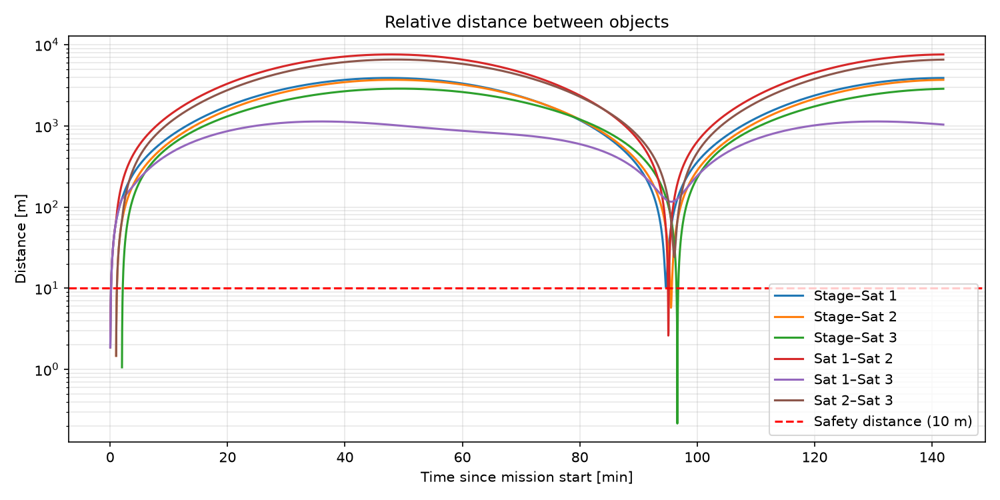
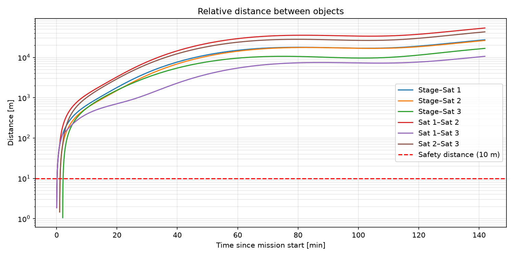
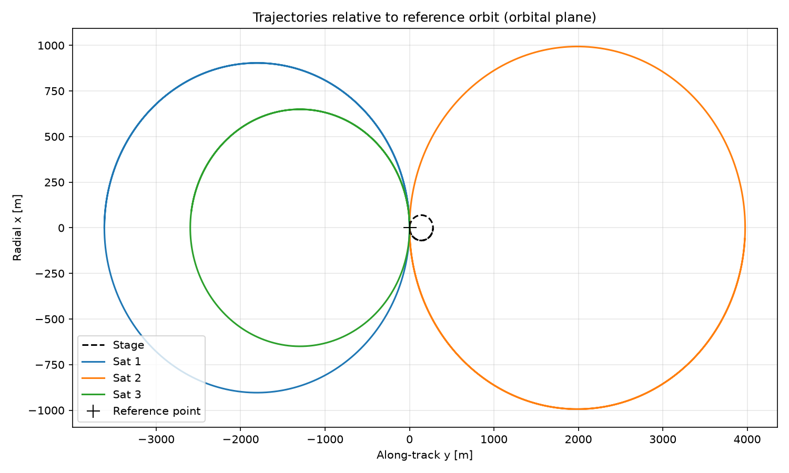
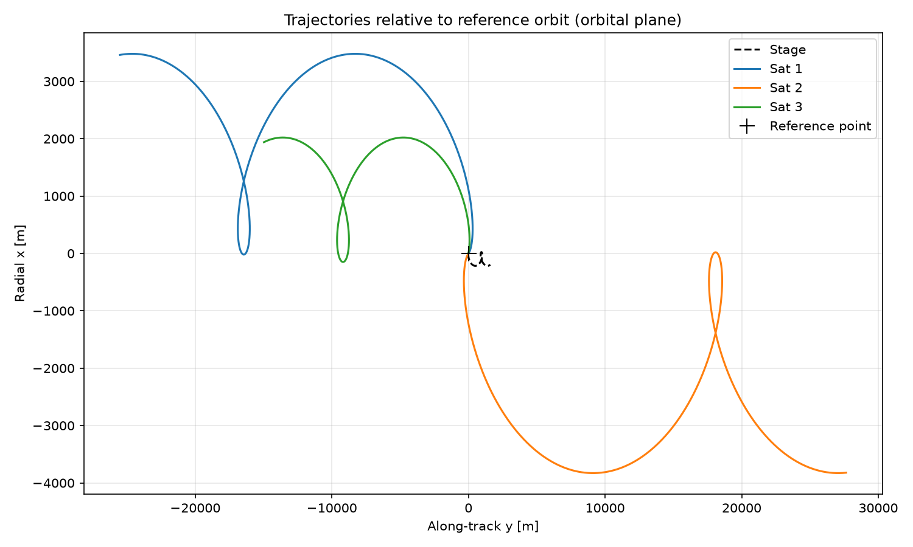

# sepsim — Satellite Separation Simulator

Simulates the relative motion of multiple satellites after separation from a
launch vehicle dispenser, to assess re-contact and collision risk between
satellites and the upper stage in the hours and days after deployment.

**Goal:** find separation sequences (timing and direction for each satellite)
that avoid re-contact and keep all objects above a minimum safety distance.

## Motivation

Multi-satellite dispensers release payloads in a predefined sequence. Orbital
relative motion is counterintuitive: a satellite pushed radially outward
returns to the dispenser after one orbit, and a satellite pushed forward ends
up *behind* it. This project explores how separation sequence, direction and
velocity affect the minimum distance between objects.

## Results (v0.2)

Same orbit (500 km), same upper stage (1200 kg), same satellites (150 kg, spring
impulse 150 N·s → exactly 1 m/s each). Only the separation directions differ.
Upper-stage recoil is included.

| Scenario 1: radial separations | Scenario 2: separations with along-track component |
|---|---|
|  |  |
|  |  |
| All objects return close to each other after one orbit (~95 min). Minimum distance 0.2 m (stage–Sat 3): **re-contact risk**. | Satellites drift apart along-track and never return. Minimum distance after clearance: **~395 m**. |

The trajectory plots show motion relative to the reference orbit (cross) in the
orbital plane; the upper stage is the dashed line. Radial pushes give closed
ellipses. Along-track pushes change the orbital period, so each satellite
drifts ≈ 17 km per orbit per m/s of along-track velocity.

**Effect of recoil:** in scenario 1, Sat 2 inherits the stage's recoil from the
first separation, so its effective push becomes 1.08 m/s instead of 1.0 m/s
and its ellipse grows. In scenario 2, the stage drifts ≈ 1.6 km from the
reference point after 1.5 orbits — recoil of a few cm/s changes the geometry
by kilometres, which is why it has to be modelled.

Note: the trajectory plots use different scales on the two axes.

## Vision

The end goal is a planning tool:

**Input** — mission and hardware parameters:
```toml
[orbit]
altitude_km = 500

[upper_stage]
mass_kg = 1200

[constraints]
safety_distance_m = 10
min_time_between_separations_s = 30

[[satellites]]
name = "Sat 1"
mass_kg = 150
spring_impulse_Ns = 120     # Δv = J / m
area_m2 = 1.2               # for drag modelling
```

**Output** — a recommended separation plan:
```
Sat 1   t =   0 s   azimuth  12°   elevation  -5°   Δv 0.80 m/s
Sat 2   t =  45 s   azimuth 168°   elevation  10°   Δv 1.50 m/s
Minimum distance (any pair, after clearance): 340 m
Collision probability (Monte Carlo): < 0.01 %
```

plus plots and a 3D visualization of the deployment (global view of the orbit
and a close-up view following the dispenser).

## Status and roadmap

**v0.1 — done**
- [x] Physical constants with sources (WGS84, EGM2008, IAU)
- [x] Clohessy–Wiltshire analytic propagation
- [x] Separation times (satellites released in sequence)
- [x] Pairwise conjunction analysis (minimum distance and time of closest approach)
- [x] Plots: relative distance over time, trajectories in the orbital plane
- [x] Demo scenarios: radial vs. along-track separation
- [x] Validation tests

**v0.2 — done**
- [x] Satellite masses and spring impulse (Δv = J / m)
- [x] Upper-stage recoil from momentum conservation, growing as the stack gets lighter
- [x] Mission propagation with the stage moving (superposition of CW responses)
- [x] Scenarios loaded from TOML files, one generic run script

**Planned**
- [ ] v0.3 — Separation plan optimization (timing and direction)
- [ ] v0.4 — Numerical propagator with J2 and atmospheric drag; CW vs. full model comparison
- [ ] v0.5 — JSON export and web-based 3D visualization
- [ ] v0.6 — Monte Carlo collision probability and robust optimization

**Future work**
- Upper-stage collision avoidance manoeuvre after deployment
- Phasing: choose separations that reduce propellant needed to reach constellation slots
- First ground station contact (e.g. Esrange) after separation

## Model

**Reference frame:** LVLH / Hill frame (RIC), centered on the reference orbit
(where the stack would be without any separations):
- x: radial, outward from Earth
- y: along-track, direction of motion
- z: cross-track, along the orbit normal

**Clohessy–Wiltshire equations** (n = mean motion of the reference orbit):

    ẍ − 3n²x − 2nẏ = 0
    ÿ + 2nẋ = 0
    z̈ + n²z = 0

The closed-form solution is used, so no numerical integration is needed.

**Separation physics:** each spring delivers an impulse J between the satellite
and the remaining stack (upper stage + satellites not yet released). Momentum
is conserved:

    Δv_sat   = +J / m_sat  · d̂
    Δv_stack = −J / m_rest · d̂

The stack gets lighter with every separation, so the recoil grows.

**Mission propagation:** because the CW equations are linear, motion from
several impulses is the sum of the motion from each impulse alone. The stage
trajectory is the sum of all recoils; a satellite inherits the recoils from
satellites released before it, plus its own push from its separation time.

**Conjunction analysis:** distances are computed between all pairs of objects
(upper stage included) at every sample time. Minimum distance is evaluated after
a clearance time, so that the initial proximity at separation is not counted.

**Assumptions and limitations:**
- Circular reference orbit
- Relative distances small compared to orbit radius
- No perturbations (J2, drag, solar radiation pressure), to be added in the
  numerical model
- Separations are instantaneous impulses (no spring stroke duration, no tip-off rotation)
- Point masses: attitude and physical size of the objects are not modelled
- Closest approach is found among sampled times only; the true minimum may lie
  between samples (default ~1.7 s spacing)
- Results are only valid within the simulated time window
- All units SI (m, s, kg)

## Validation

| Test | Expected result |
|---|---|
| Orbital period at 500 km | ≈ 94.6 min |
| Radial push, 1 m/s | Returns to origin after one orbit |
| Along-track push, 1 m/s | Drifts 6π/n ≈ 17 km *behind* after one orbit |
| Cross-track push | Pure oscillation in z, no coupling to x/y |
| Identical separations | Zero distance between the two satellites at all times |
| Radial push, conjunction analysis | Re-contact with dispenser detected at t ≈ one orbit |
| Along-track push, conjunction analysis | No return to the dispenser after clearance |
| Delayed separation | Same trajectory as immediate separation, shifted in time |
| Separation state from direction + speed | Requested speed and direction, starting at the dispenser |
| Momentum at each separation | m_sat · Δv_sat + m_rest · Δv_stack = 0 |
| Recoil vs. stack mass | Recoil grows as satellites are released (J/1500 → J/1200 kg) |
| Very heavy stage (10¹² kg) | Same trajectories as v0.1 (stage stays at origin) |
| Centre of mass of all objects | Stays at the reference point at all times (internal forces only) |
| Satellite before its separation | Identical state to the upper stage |
| Scenario loading | TOML values parsed correctly, km converted to m |

## Getting started

Requires [uv](https://docs.astral.sh/uv/).

```bash
uv sync
uv run pytest                                                 # run all tests
uv run python examples/run_scenario.py scenarios/scenario1.toml   # radial separations
uv run python examples/run_scenario.py scenarios/scenario2.toml   # along-track separations
```

Figures are written to `results/`. To create a new scenario, copy a TOML file
in `scenarios/` and change the values — no code changes needed:

```toml
name = "Scenario 1: radial separations"
altitude_km = 500
stage_mass_kg = 1200

[[satellites]]
name = "Sat 1"
mass_kg = 150
spring_impulse_Ns = 150
direction = [1, 0, 0]       # LVLH: radial, along-track, cross-track
t_sep_s = 0
```

## Project structure

```
src/sepsim/
├── constants.py            # physical constants with sources
├── scenario.py             # Satellite and Mission data classes, TOML loading
├── dynamics/
│   ├── cw.py               # Clohessy–Wiltshire propagation, separation times
│   └── separation.py       # separation kicks with recoil, mission propagation
├── analysis/
│   └── conjunctions.py     # pairwise distances, closest approach
└── viz/
    └── plots.py            # distance and trajectory plots
scenarios/
├── scenario1.toml          # radial separations
└── scenario2.toml          # separations with along-track component
examples/
└── run_scenario.py         # run any scenario: simulation, analysis, plots
tests/
├── test_constants.py
├── test_cw.py
├── test_conjunctions.py
├── test_separation.py
├── test_propagate_mission.py
└── test_scenario.py
docs/images/                # figures used in this README
```

## References

- Clohessy, W. H. & Wiltshire, R. S. (1960). *Terminal Guidance System for
  Satellite Rendezvous.* Journal of the Aerospace Sciences, 27(9).
- Curtis, H. D. (2014). *Orbital Mechanics for Engineering Students* (3rd ed.).
- Vallado, D. A. *Fundamentals of Astrodynamics and Applications.*
- NIMA (2000). *WGS84 — Department of Defense World Geodetic System 1984.*